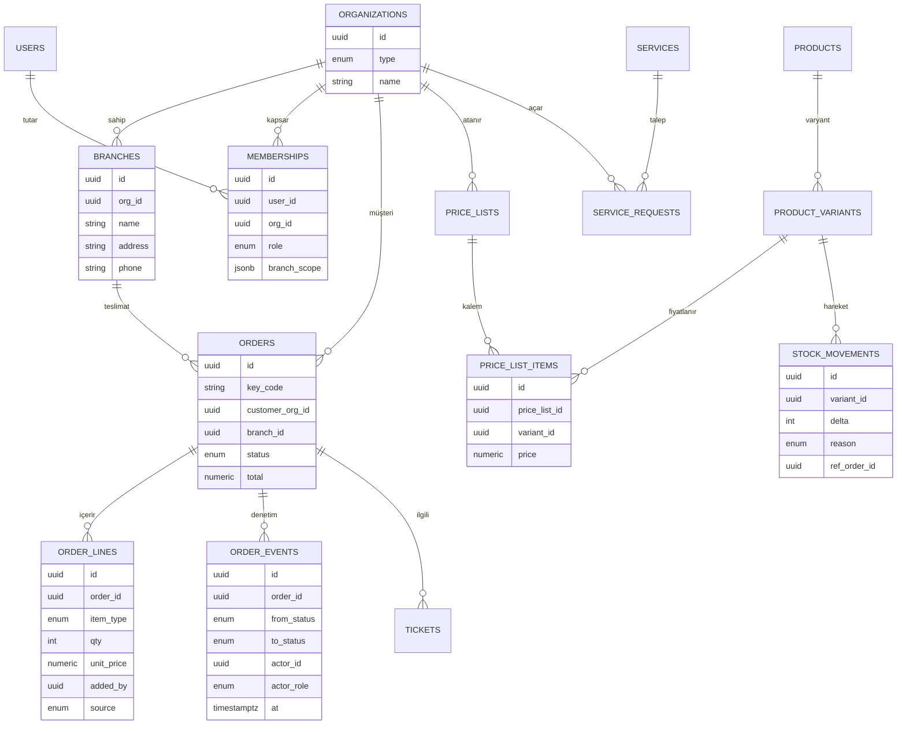

# RoasteryClub Yenileme Mimarisi

> **Durum:** taslak v1 · **Tarih:** 2026-09-07 · **Kapsam:** baştan ürün + altyapı
> Bu belge yaşayan referanstır. Kararlar netleştikçe burada güncellenir.

---

## 00 · İçindekiler

1. [Özet](#01--özet)
2. [Yaklaşım — küçük başla, yeniden yazmadan büyü](#02--küçük-başla-yeniden-yazmadan-büyü)
3. [Teknoloji yığını](#03--teknoloji-yığını)
4. [Sistem topolojisi](#04--sistem-topolojisi)
5. [Veri modeli](#05--veri-modeli)
6. [Sipariş durum makinesi](#06--sipariş-durum-makinesi)
7. [Roller ve yetki](#07--roller-ve-yetki)
8. [Kimlik doğrulama](#08--kimlik-doğrulama)
9. [Mağaza sürümü kısıtı](#09--mağaza-sürümü-kısıtı)
10. [Yol haritası](#10--yol-haritası)
11. [Maliyet](#11--maliyet)
12. [Açık kararlar ve riskler](#12--açık-kararlar-ve-riskler)
13. [UX ve tasarım sistemi](#13--ux-ve-tasarım-sistemi)

---

## 01 · Özet

Mevcut uygulama Expo (React Native) + Firebase üzerinde kurulu; iki ayrı Firebase SDK'sı bir arada,
güvenlik kuralları ile istemci yazımları çelişiyor, veri modeli tutarsız ve repoda gizli anahtarlar
var. Uygulama henüz canlı değil, gerçek kullanıcı yok — bu yüzden **veri göçü gerekmiyor**, temiz
kurulum yapılabilir.

Hedef sistem klasik bir e-ticaret değil, **B2B ERP-lite**: müşteriye özel katalog ve fiyat, çok
şubeli firmalar, departmanlar arası (satış → üretim → sevkiyat) role-kilitli sipariş akışı, siparişe
sonradan kalem ekleme, destek talepleri, hizmet ve randevular, hedefli duyurular, Excel içe/dışa
aktarım ve kapsamlı bir web yönetim paneli.

Bu iş yükü ilişkisel veriyle çalışır. Öneri: **kendi backend'i** (TypeScript + PostgreSQL), ama her
parçası yönetilen servislerde — tek kişi bakacağı için yamalanacak sunucu bırakmıyoruz. Mobil taraf
mevcut Expo projesi olarak kalır; mağazalarda **yeni sürüm** olarak yayınlanır, yeni uygulama değil.

### Neden Firebase'den çıkılıyor

| Spec maddesi | Firestore'da | Postgres'te |
|---|---|---|
| Müşteriye özel fiyat + özel katalog | Her fiyat/kural değişiminde fan-out yazım veya client-side filtre (bugünkü app böyle → "özel ürün" aslında gizli değil) | `price_list` + `visibility_rule` tabloları, JOIN ile çözüm |
| Departman bazlı, role-kilitli durum geçişi | Rules bunu ifade edemez → her yazım için Function şart → zaten backend yazıyorsun, kötüsünü | Tek yerde `transition()` + izin matrisi |
| Siparişe sonradan kalem ekleme + kim-ne-yaptı | Denormalize event kopyaları | Append-only `order_events` + FK |
| Raporlar | Ayrı BigQuery export (şu an bağlı, muhtemelen ödeniyor) | `GROUP BY` |
| Excel toplu upsert + rollback | 500'lük batch limiti, çok-döküman transaction zayıf | Tek transaction |
| 200 ürünlük katalog açılışı | ~200 döküman okuma / açılış (okuma başına ücret) | 1 sorgu |

**Çıkışın maliyeti:** auth'u yeniden yaz, sunucu barındır, yedek/uptime senin. Bunu *yönetilen
Postgres + PaaS katmanı + Sentry* ile küçük tutuyoruz.

---

## 02 · Küçük başla, yeniden yazmadan büyü

Şirket büyüyor ama 1–2 yıllık kesin rakam yok. Seçilen mimari küçük ölçekte (<50 firma, <500
sipariş/ay) tek Postgres + yönetilen hosting ile rahat çalışır; büyük veri baskısı ancak 5.000+
sipariş/ay seviyesinde gündeme gelir ve o noktada geçiş kod değişikliği değil, altyapı ayarıdır.
Şart olan, şimdi geri dönüşü pahalı kararları doğru vermek.

| Şimdi doğru yapılmalı — sonradan pahalı | Sonraya ertelenebilir — ucuz eklenir |
|---|---|
| İlişkisel şema: firma / şube / fiyat listesi / görünürlük kuralları normalize | Read-replica (rapor yükü artınca) |
| Append-only defterler: `stock_movements`, `order_events` | Redis önbellek (Postgres yavaşlayınca) |
| Sunucu-otoriter fiyat ve izin — istemciye asla güvenme | Ayrı worker servisi (kuyruk büyüyünce) |
| Durum makinesi + yetki matrisi tek yerde (`packages/shared`) | Metabase / veri ambarı |
| Benzersiz `key_code`, `outbox` olay tablosu | Socket.IO (SSE yetmeyince) |
| Migration disiplini (Prisma) — şema değişimi izlenebilir | Yatay API ölçeklendirme / autoscale |

### Ölçek kademeleri

| | Firma sayısı | Sipariş/ay | Aynı anda aktif personel | Karşılığı |
|---|---|---|---|---|
| **A – Küçük** | < 50 | < 500 | 1–5 | Tek küçük sunucu, tek Postgres, Redis'e gerek yok (kuyruk Postgres üstünde) |
| **B – Orta** ← hedef | 50–300 | 500–5.000 | 5–20 | Yönetilen Postgres + yedek, Redis (cache+kuyruk), ayrı worker |
| **C – Büyük** | 300+ | 5.000+ | 20+ | Read-replica, ayrı Metabase, API yatay ölçek |

**Hedef: B kademesi** (~300 müşteri firma). Bu kademe tek yönetilen Postgres ile karşılanır;
C'ye geçiş kod değişikliği değil, altyapı ayarıdır (read-replica, Redis, ayrı worker eklemek).

---

## 03 · Teknoloji yığını

| Katman | Seçim | Gerekçe / alternatif |
|---|---|---|
| Dil | **TypeScript** (uçtan uca) | Mevcut ekip bilgisi; Cloud Functions zaten TS |
| Monorepo | **Turborepo + pnpm** | `apps/api`, `apps/admin`, `apps/mobile`, `packages/shared` |
| Backend | **NestJS** (Fastify adapter) | Modüler — çok sayıda bounded context için guard/DI yapısı. Alt: Fastify + elle yapı |
| API stili | **tRPC** | Kapalı sistem, mobil + admin ikisi de TS → uçtan uca tip, codegen yok. Alt: REST + OpenAPI |
| Veritabanı | **PostgreSQL** (yönetilen: Neon / Railway) | İlişkisel veri bu projenin özü; otomatik yedek + PITR |
| ORM | **Prisma** | Migration + tip güvenliği + hız. Alt: Drizzle (ham SQL) |
| Kuyruk | **pg-boss** (Postgres üstünde) | Başta ayrı Redis yok; bildirim/e-posta/import işleri. İhtiyaç olursa Redis + BullMQ |
| Kimlik | **Kendi modülü:** telefon + OTP + JWT (şifresiz) | Kalıcı oturum; kısa access + uzun rotating refresh (DB'de iptal edilebilir). Alt: Supabase Auth |
| SMS / OTP | **Netgsm** veya İletimerkezi | Kayıtlı başlık; TR yerel sağlayıcı Firebase Phone Auth'tan çok ucuz. Yedek: Twilio Verify |
| Dosya | **Cloudflare R2** (S3 API) | Egress ücretsiz; ürün görselleri, Excel, destek ekleri. Yükleme sonrası `sharp` ile boyut |
| Push | **Expo Push** | FCM/APNs sarmalı, ücretsiz; app zaten Expo |
| Realtime | **SSE** (müşteri sipariş takibi) | Tek yön, tek servis. Admin canlı panosu gerekirse Socket.IO |
| Admin panel | **Next.js + Refine** → Vercel | 25+ yönetim alanı; Refine RBAC + veri gridi + CRUD hızlandırır |
| Mobil | **Expo / React Native** (mevcut proje) | Firebase SDK'ları çıkar → tek tRPC client; sepet lokal kalıcı (MMKV) |
| Raporlama | **Metabase** (PG'ye bağlı) — Faz 6 | Panel "Raporlar" bölümünü büyük ölçüde bedava karşılar |
| Hosting | **Railway** veya Render | git push → deploy; managed Postgres aynı platformda. Yamalanacak makine yok |
| Gözlem | **Sentry** + Uptime Kuma + Better Stack | Mobil + backend hata takibi; free tier ile başlar |
| CI/CD | GitHub Actions → Docker → deploy | Mobil: EAS Build + EAS Submit (mevcut proje) |

Sabit kararlar: TypeScript + NestJS + PostgreSQL + Prisma + tRPC, mobil Expo devam.
Değişebilen: "nerede çalışıyor ve kaç parça" (Railway tek kutu → ileride ayrık servisler).

---

## 04 · Sistem topolojisi

```
İSTEMCİLER                ÇEKİRDEK                     VERİ & SERVİSLER
─────────────             ─────────────                ──────────────────
Müşteri app (Expo)   ┐                            ┌──  PostgreSQL (yönetilen, yedekli)
Saha personeli app   ├──►  API (NestJS · tRPC)  ──┤
  (satış/üretim/     │     Worker (pg-boss)       ├──  Cloudflare R2 (görsel · dosya)
   sevkiyat)         │     SSE kanalı             │
Yönetim paneli       ┘     [Railway / Render]     ├──  Netgsm (OTP SMS)
  (Next.js · Vercel)                              └──  Expo Push (bildirim)
```

Tüm iş kuralları (fiyat çözümü, görünürlük, durum geçişi, stok düşümü) API'de; istemciler yalnızca
sunucunun döndürdüğünü gösterir. Domain olayları `outbox` tablosuna yazılır, worker bunları
bildirim / dış senkron işine çevirir.

---

## 05 · Veri modeli

Merkez kavram **organization** (tip: `producer` | `customer`): sistemde bir üretici, N müşteri firma.
Her müşteri firmasının şubeleri, kullanıcıları ve kendine atanmış fiyat listesi / görünürlük
kuralları olur.



### Çekirdek dışı tablolar

| Alan | Tablolar |
|---|---|
| Üyelik başvurusu | `membership_requests` |
| Katalog görünürlüğü | `visibility_rules` (subject · target · effect), `customer_groups`, `customer_group_members` |
| Stok gösterimi | `stock_display_overrides` (product → `in_stock` \| `limited` \| `preorder` \| `incoming` \| `closed`) |
| Destek | `tickets`, `ticket_messages`, `attachments` |
| Hizmet & randevu | `services`, `service_requests`, `appointments` |
| Duyuru | `announcements`, `announcement_targets` (all \| group \| org[]) |
| Bildirim | `notifications`, `notification_deliveries`, `device_tokens` |
| Veri aktarım | `import_jobs` (dry-run önizleme · satır hataları · transaction'lı commit) |
| Denetim | `activity_log`, `outbox` |

### Fiyat çözümü

Bir varyantın müşteriye fiyatı: **müşteriye özel liste → müşteri grubu listesi → varsayılan liste**
sırasıyla aranır. İlk eşleşen kazanır. Kampanya / miktar kuralları sonradan `price_list_items`
üzerine tarih + koşul alanı olarak eklenir. Sipariş kalemine fiyat *ekleme anında* sunucudan
snapshot'lanır — istemciden gelen fiyata asla güvenilmez.

### Stok

Çıplak sayı tutulmaz; `stock_movements` append-only defterinden bakiye hesaplanır. Müşteriye
gösterilen durum (`stock_display_overrides`) gerçek bakiyeden bağımsızdır ve üretici kontrolündedir
(otomatik eşik ya da elle).

---

## 06 · Sipariş durum makinesi

Her aşamaya geçişi yalnızca o aşamadan sorumlu rol tetikleyebilir. Geçiş bir izin tablosuna karşı
doğrulanır; her geçiş `order_events`'e aktör + rol + not ile yazılır. Stok, **Onaylandı** anında aynı
transaction içinde `stock_movements`'a negatif hareketle düşer (ön sipariş işaretli ürünlerde eksiye
izin verilir).

```
Sipariş Verildi ─► Onaylandı ─► Üretimde ─► Üretim Tamamlandı ─► Sevkiyata Hazır ─► Yolda ─► Teslim Edildi
   (Müşteri)       (Satış)     (Üretim)      (Üretim)             (Üretim)         (Sevkiyat) (Sevkiyat)

Yan durumlar:  İptal (Satış/Üretim/Yönetici) · Teslimat Sorunu (Sevkiyat) · Beklemede (Yönetici)
```

- Üretici yöneticisi gerektiğinde tüm geçişleri yapabilir.
- Hiçbir personel kendi yetkisi dışındaki durumu değiştiremez (üretim `Teslim Edildi` yapamaz).
- Kalem ekleme her aşamada yetkili personelce mümkündür; eklenen kalem ürün *veya* hizmet olabilir
  (`item_type`) ve `added_by` / `added_at` / `source` ile kaydedilir. Sipariş toplamı her mutasyonda
  sunucuda yeniden hesaplanır.

---

## 07 · Roller ve yetki

Model: **rol + kapsam**. Bir kullanıcının bir veya daha çok `membership` kaydı vardır:
`(user, org, role, branch_scope?)`. Üretici personeli üretici org'una, müşteri kullanıcıları kendi
firmalarına — istenirse belirli şubelere — bağlıdır. İzinler tek bir capability matrisinde tanımlanır,
guard tek yerde uygular.

| Rol | Katalog / fiyat | Sipariş | Üretim | Sevkiyat | Müşteri / üye | Duyuru / rapor |
|---|---|---|---|---|---|---|
| Üretici Yöneticisi | tam | tam | tam | tam | tam | tam |
| Satış Personeli | görür | onay + kalem | — | — | başvuru + müşteri | görür |
| Üretim Personeli | görür (fiyat + stok) | kendi aşaması | tam | — | — | — |
| Sevkiyat Personeli | — | kendi aşaması + kalem | — | tam | — | — |
| Müşteri Firma Yöneticisi | kendine açık olan | tüm şubeler: oluştur + takip | — | — | kendi kullanıcıları | kendine gelen |
| Şube Müdürü | kendine açık olan | kendi şubesi: oluştur + takip | — | — | — | kendine gelen |
| Müşteri Kullanıcısı | kendine açık olan | yetki verilen şube | — | — | — | kendine gelen |

Bildirimler role göre yönlendirilir: yeni başvuru + yeni sipariş → satış; üretime düşen sipariş →
üretim; sevkiyata hazır → sevkiyat; durum değişimi + teslimat + destek yanıtı → ilgili müşteri;
operasyonel uyarılar → yönetici.

---

## 08 · Kimlik doğrulama

**Telefon doğrulama zorunlu. Şifre yok — kimlik yalnızca telefon + OTP.**

1. Kayıt / yeni cihaz / yeniden giriş: telefon numarası girilir (E.164, `+90…`).
2. Sunucu OTP üretir → Netgsm ile SMS. Kod 5 dk TTL; telefon + IP başına hız sınırı, 3 deneme.
3. Kod doğrulanır. İlk kayıtta firma bilgileri alınır → `membership_requests`'e düşer, yönetici
   onayı bekler (onayla / reddet / düzenle / rol ata / şube oluştur).
4. Onay sonrası: kısa ömürlü **access JWT** (~15 dk) + **uzun ömürlü rotating refresh token**
   (DB'de, iptal edilebilir; ~60–90 gün kayan süre) verilir. Refresh token cihazda güvenli depoda
   tutulur (`expo-secure-store` / Keychain / Keystore).
5. **Oturum kalıcıdır.** Uygulama süre dolmadan her açıldığında refresh sessizce yenilenir —
   kullanıcıya bir daha OTP sorulmaz.

**OTP yalnızca şu durumlarda tekrar istenir:**

- Kullanıcı bilerek "Çıkış yap" dediğinde (refresh token iptal edilir)
- Yeni bir cihazdan giriş
- Refresh token süresi dolduğunda (uzun süre uygulamayı hiç açmamak)

**KVKK:** açık rıza metni, OTP log saklama süresi, SMS başlık tescili.

---

## 09 · Mağaza sürümü kısıtı

Mobil, mevcut Expo projesi olarak kalır; içi (ekranlar + veri katmanı → yeni backend) yenilenir,
kimlik alanlarına dokunulmaz. Çıkan binary mevcut uygulamanın yeni sürümüdür — yeni uygulama değil.

### Aynı kalmalı (kimlik)

| Alan | Değer |
|---|---|
| iOS bundle ID | `com.husnytarik.roasteryclub` |
| Android package | `com.husnytarik.roasteryclub` |
| App Store Connect / Play Console kaydı | mevcut — dokunma |
| Android imza anahtarı | mevcut keystore — **doğrula** (aşağıya bak) |
| EAS proje kimliği | `app.config.ts` · `extra.eas.projectId` |
| Apple Developer hesabı / team | aynı |

### Değişecek (yalnızca sürüm)

| Alan | Şu an | Sonraki |
|---|---|---|
| `version` | 2.2.4 | 3.0.0 |
| `ios.buildNumber` | 3 | 4+ |
| `android.versionCode` | 27 | 28+ (mutlaka daha büyük) |

### Tek gerçek risk: Android imza anahtarı

Android güncellemesi **aynı imzayla** gelmek zorunda. Play Console → Uygulama imzalama durumunu
doğrula:

- **Play App Signing açıksa** → upload key sıfırlanabilir, rahat.
- **Değilse** → orijinal keystore şart. Kaybedilirse uygulama güncellenemez, yeni liste açmak
  gerekir.

Yapılacaklar: doğru keystore'u git dışında, çevrimdışı yedekle; `credentials.json`, `.env` ve
keystore'ları git geçmişinden temizle (`git filter-repo`), `.gitignore`'a ekle.

Native bağımlılıklar değiştiği için (`@react-native-firebase/*` kalkacak) bu bir OTA güncellemesi
değil — yeni binary + mağaza incelemesi gerekir. Çekirdek amaç aynı kaldığı için (B2B kahve sipariş)
inceleme riski düşük; ekran görüntüleri ve açıklama güncellenir.

---

## 10 · Yol haritası

| Faz | Ad | İçerik |
|---|---|---|
| **0** | UX temeli | ~14 çekirdek ekranın akış haritası + wireframe · tasarım tokenları (`packages/shared`) · mobil + web bileşen kiti · sipariş durumu / katalog kartı / görev kutusu prototipleri (§13) |
| **1** | Temel | Monorepo · şema (org / şube / kullanıcı / RBAC) · telefon-OTP auth · API iskeleti · admin kabuğu · CI/CD |
| **2** | Katalog, fiyat, görünürlük | Ürün + varyant · fiyat listeleri · görünürlük kuralları · stok gösterimi · Excel içe/dışa aktarım |
| **3** | Sipariş & operasyon | Sipariş oluşturma · durum makinesi · departman ekranları · kalem ekleme · olay/denetim · stok defteri · role özel bildirim |
| **4** | Müşteri uygulaması | Ana sayfa / duyurular · katalog · kalıcı sepet · sipariş takip (SSE) · push · yeni sürüm mağazaya |
| **5** | Destek & hizmet | Destek talepleri (`key_code` ile sipariş bağı) · hizmet kataloğu · randevu · departman yönlendirme |
| **6** | Raporlama & entegrasyon | Metabase · Google Sheets ürün/fiyat senkronu (idempotent upsert, `code` anahtarlı) · cilalama |

---

## 11 · Maliyet (aylık, kaba, USD)

| Kalem | Servis | Aylık |
|---|---|---|
| API + worker | Railway / Render | 10 – 25 |
| PostgreSQL (yönetilen) | aynı platform veya Neon | 0 – 20 |
| Yönetim paneli | Vercel Hobby → Pro | 0 – 20 |
| Dosya depolama | Cloudflare R2 | 1 – 5 |
| Hata takibi | Sentry Developer → Team | 0 – 26 |
| Push | Expo Push | 0 |
| SMS / OTP | Netgsm | kullanıma bağlı |
| Alan adı | — | ~1 (yıllık ~15) |

Başlangıç taban maliyeti **~25–75 USD/ay + SMS kullanımı**. Bu; Firestore okuma ücreti, Firebase
Phone Auth, Cloud Functions çağrıları ve BigQuery aktarımının *tamamının* yerine geçer.

---

## 12 · Açık kararlar ve riskler

| Konu | Karar | Durum |
|---|---|---|
| Kimlik modeli | Şifresiz; telefon + OTP. Oturum kalıcı — sadece çıkış / yeni cihaz / token süresi dolunca OTP | ✅ karar verildi |
| API stili | tRPC — 3. parti API yok, veriler yalnızca bizde; her iki istemci de TypeScript | ✅ karar verildi |
| Ölçek | ~300 müşteri firma → B kademesi. Plan değişmiyor, tek Postgres yeter | ✅ karar verildi |
| Android imza anahtarı | Play App Signing açık mı? / orijinal keystore elde mi? | ⏳ kullanıcı kontrol edecek — ilk submit öncesi blocker |
| Çok üreticili (multi-tenant) | Tek üretici varsayımı — şemada imkânsız kılınmayacak | ✅ varsayım kabul |
| Müşteri grubu derinliği | Basit grup şimdi / kurallı segmentasyon sonra | ⏳ sonra |
| Repodaki gizli anahtarlar | keystore + `credentials.json` + `.env` git geçmişinden temizlik | ⏳ yapılacak |

---

## 13 · UX ve tasarım sistemi

Mevcut uygulamanın UX'i zayıf ve yenilemede ayrı bir iş kalemi. Görülen sorunlar: her ekranda
işlevsiz logo filigranı; her bloğa aynı kart + gölge + yarıçap (görsel hiyerarşi yok); müşteri sekme
çubuğu `display:none` (navigasyon belirsiz); tasarım sistemi yok (tema dosyasında alfa hileleri,
tanımlı ama kullanılmayan koyu palet); boş durumlar yalnızca "Henüz yok" yazısı; formlar satır içi
stilli ham `TextInput`; web SDK / native SDK karışık, ekran başına farklı desen.

### Üç yüzey, üç ayrı tasarım hedefi

| Yüzey | Kullanıcı | İlke |
|---|---|---|
| **Müşteri app** (mobil) | firma yöneticisi, şube müdürü, müşteri kullanıcısı | Ölü basit: **gör → sipariş → takip → bildirim → destek**. Az ekran, büyük dokunma alanları, tek elle kullanım, hızlı tekrar sipariş |
| **Saha personeli app** (mobil) | satış / üretim / sevkiyat | Göreve odaklı: "bana düşen işler" listesi, tek dokunuşla durum ilerletme, minimum form alanı, koridorda ayakta kullanılabilir |
| **Yönetim paneli** (web) | üretici yöneticisi + ofis | Bilgi yoğun: tablo + filtre + toplu işlem. Okunmaz, **taranır ve işletilir**; özet önce, detay sonra |

### Tasarım sistemi — Faz 0 çıktısı, sonradan eklenmez

- **Tokenlar** (`packages/shared`, tek kaynak): renk, tip ölçeği, boşluk ölçeği, yarıçap (role göre —
  her şeye tek yarıçap değil), yükseklik/gölge (role göre). Koyu tema baştan token seviyesinde tanımlı.
- **Bileşen kiti**: mobil `packages/ui-native` (token tabanlı primitifler; taban için Tamagui
  değerlendirilir), web `apps/admin` içinde shadcn/ui + Refine. İkisi de aynı tokenları okur.
- **Tipografi**: gerçek ölçek ve ağırlık hiyerarşisi — sistem varsayılanı 14px her yerde değil.
- **Anlamsal renk**: sipariş durumlarının her biri ayrı renk + ikon, marka renginden bağımsız;
  iyi / uyarı / kritik ayrımı ayrı bir eksen.
- **İkonlar**: tek set (lucide veya phosphor). **Dil**: tümü Türkçe; hata mesajı "ne yanlış +
  nasıl düzeltilir" biçiminde, özür veya belirsizlik yok.
- **Erişilebilirlik**: min 44pt dokunma hedefi, dinamik yazı tipi boyutu, WCAG AA kontrast,
  `prefers-reduced-motion`.

### Çivilenecek kalıplar

- **Sipariş durumu = zaman çizelgesi (stepper).** 7 aşamalı akış görselleştirilir: geçmiş aşamalar
  işaretli + zaman damgalı, mevcut aşama vurgulu, sonraki aşamalar soluk; tahmini teslim tarihi;
  yan durumlar (İptal / Teslimat Sorunu / Beklemede) net bir uyarı bloğu. Müşterinin en sık baktığı
  ekran budur — en yüksek tasarım yatırımı buraya.
- **Tek dokunuşla tekrar sipariş.** "Geçen siparişi tekrarla" → sepet önden dolu, müşteri yalnızca
  onaylar.
- **Katalog kartı.** Müşterinin *kendi* fiyatı, stok rozeti (`stock_display_overrides` durumu),
  varyant + öğütme seçimi satır içi, adet stepper'ı ile sepete ekle. Gizli ürün gerçekten görünmez
  (sunucu filtreli).
- **Sepet + ödeme akışı.** Kalıcı (MMKV); adımlar net: şube seç → gözden geçir (kalem + adet + ara
  toplam) → onayla. Fiyatlar sunucudan.
- **Personel görev kutusu.** "Bana düşen" / "tüm siparişler" segmenti; kart üstünde büyük tek
  "İlerlet" butonu (bir sonraki role uygun aşamaya); yetki dışı geçiş butonu hiç render edilmez.
- **Boş durumlar.** Her biri bir sonraki eylemi öneren bir buton taşır ("İlk siparişini oluştur",
  "Kataloğu gözat").
- **Bildirim → derin bağlantı.** Push'a dokunma doğrudan ilgili sipariş / talep / duyuru ekranını
  açar, ana sayfayı değil.
- **Destek.** `key_code` ile siparişe bağlı; thread görünümü, ekli görsel, durum (açık / yanıtlandı
  / kapandı).
- **Duyurular.** Ana sayfada kart akışı, okunmadı göstergesi, hedefli (`announcement_targets`).
- **Yönetim paneli sipariş panosu.** Duruma göre kolonlar veya filtrelenebilir tablo; satırda
  durum çipi + firma + şube + tutar + yaş; toplu işlem; satıra tıklama = yan panelde detay.

### Süreç

1. ~14 çekirdek ekranın akış haritası + düşük çözünürlük wireframe — kod öncesi, bu belgeye
   `docs/ux/` altında eklenir.
2. Tasarım tokenları + bileşen kiti (Faz 0).
3. Yüksek trafikli ekranlar önce yüksek çözünürlük: sipariş takip, katalog, sepet/ödeme,
   personel görev kutusu, admin sipariş panosu.
4. Kalan ekranlar kit üzerinden hızlı kurulur.

---

## Ek · Kaynak spec

Ürün tanımı 26 maddelik spec olarak `docs/SPEC.md` altında tutulur. Bu mimari belge o spec'i
altyapıya çevirir; ikisi birlikte okunur.
